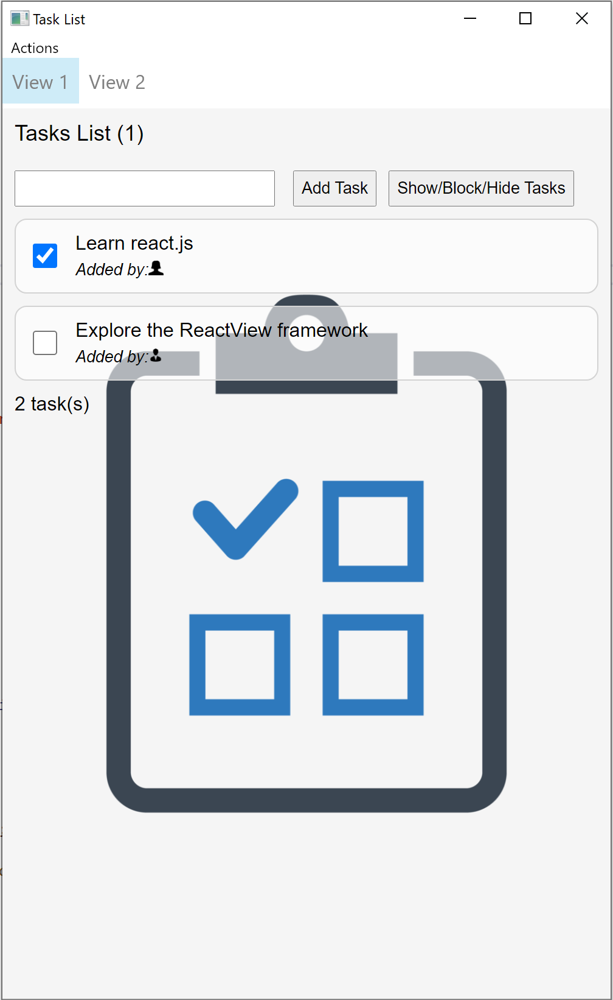

# ReactView

ReactView is a framework for building react.js based UIs that can be hosted in Avalonia/WPF applications.
Using this framework you can build .NET desktop applications that run on Windows or macOS (using the Avalonia version) and mix TypeScript and .NET code in the same app in a seamless way.

## Documentation

See the [Sample.Avalonia](Sample.Avalonia) project for an example of a Task List application that showcases most of the functionalities provided by this framework.

  

## Getting Started

1) Add the ReactViewControl-Avalonia (or ReactViewControl-WPF) and ReactView.Build Nuget packages to your WPF/Avalonia project.
2) Follow [these](ReactView.Build/readme.md "Instructions") instructions
3) For more details check the Sample project.

## Releases
Stable binaries are released on NuGet, and contain everything you need to start creating ReactView based apps.
- 
- 
- 

# ReactView.Build

ReactView.Build is the companion MSBuild package of the ReactView framework. It generates the C# bindings from the TypeScript declarations of the views and bundles all the view assets into the application assembly. See [ReactView.Build/readme.md](ReactView.Build/readme.md) for the project setup and the properties it exposes.

## Build pre-requisites
- NodeJS 20 or later
- .NET SDK

The package ships no Node modules. Its dependencies are described by `ReactView.Build/tools/package-lock.json` and installed once per machine on the first build that uses the package.

## Versioning
The versioning system works as follows:

`<major>.<cef_version>.<patch>`

Whenever you fix a bug, please increase the patch version. \
Whenever you bring a new feature, please increase the major version. \
Use the minor version for the current cef version.

# TODO
- Improve documentation
